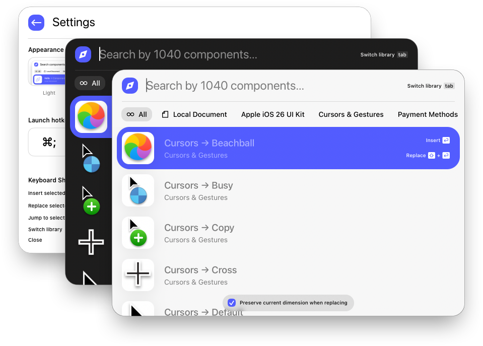

# Component Browser

Find and insert components from your Sketch document and enabled libraries. Search by name, switch between sources, or replace selected layers using the keyboard.

The browser opens as a compact search field and expands as you type. To browse without a search, press ↓ or Tab. Previews load in the background and stay cached between Sketch sessions.

## Installation

1. Download `ComponentBrowser.sketchplugin.zip` from the [latest release](https://github.com/funk4d/Component-Browser-Sketch-Plugin/releases/latest).
2. Unzip it and double-click `ComponentBrowser.sketchplugin` to install.

## Using it

Press ⌘; or choose **Plugins → Component Browser → Launch** in Sketch. You can set a different shortcut in Settings.

Choose **All**, **Local Document**, or a library to narrow your search. Press Enter to insert a component, or Shift + Enter to replace the layers selected on the canvas.

Replacing keeps each layer's position and, by default, its dimensions. Uncheck **Preserve current dimension when replacing** to use the component's original size.

Click the logo to open Settings and change the launch shortcut or appearance. Drag the window to move it.

## Keyboard shortcuts

| Key | Action |
| --- | --- |
| Shift + ⌘ + ; | Launch Component Browser |
| ↑ / ↓ | Select a component |
| Tab / Shift + Tab | Next / previous source |
| Enter | Insert the selected component |
| Shift + Enter | Replace selected layers |
| Alt + Enter | Jump to selected component |
| Option + Enter | Open the component in its source document |
| Esc | Close the browser |

## Support

Created by [Dmytro Shevchuk](https://github.com/funk4d). If you find it useful, you can [support development on Ko-fi](https://ko-fi.com/X0Z520U88Y).

## License

MIT
